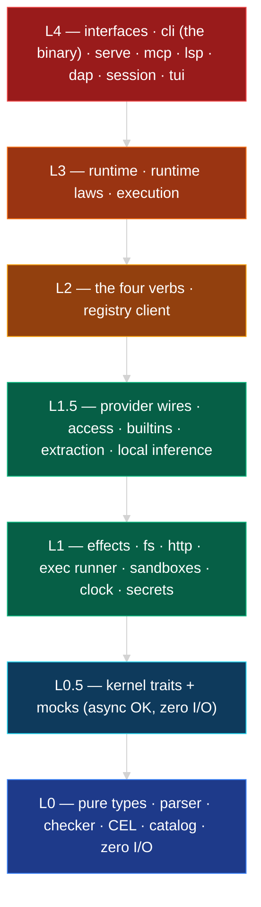

import { STATUS } from "/snippets/_status-snapshot.mdx";

You run **one `nika` binary**. Internally, at v{STATUS.version}, it is a
workspace of {STATUS.cratesWorkspace} crates ({STATUS.cratesAdmitted}
admitted, {STATUS.wipCrates.length} pre-admission) organized in layers:
**L0, L0.5, L1, L1.5, L2, L3 and L4**. Every workspace-local dependency points
downward, and a CI script (`check-layering.sh`) fails the build on any upward
import. Workflow authors do not pick a layer: this page is the engine's crate
contract.

<Note>
  **Canonical source:** [`docs/architecture/crate-layer-registry.md`](https://github.com/supernovae-st/nika/blob/v0.123.0/docs/architecture/crate-layer-registry.md)
  and the `[workspace.metadata.diamond]` table of the engine's `Cargo.toml`.
  This page curates the layer model for readers; the engine repository holds
  the manifest next to the enforcement script.
</Note>

## Mechanical sort test

Every new crate answers these questions in order. First hit wins.

<Steps>
  <Step title="Does it expose a transport or UI surface (CLI, HTTP, MCP, LSP, DAP, terminal)?">
    → **L4** (interfaces). The `nika` binary itself is built from `nika-cli`
    here.
  </Step>
  <Step title="Does it orchestrate a whole workflow or enforce runtime law?">
    → **L3** (runtime and execution)
  </Step>
  <Step title="Does it implement a verb, or a client a verb calls?">
    → **L2** (verbs)
  </Step>
  <Step title="Is it a provider wire, a builtin tool, extraction or local inference?">
    → **L1.5** (provider and builtin effects)
  </Step>
  <Step title="Is it a primitive with I/O (fs, net, process, sandbox, clock)?">
    → **L1** (effects)
  </Step>
  <Step title="None of the above?">
    → **L0** (pure, sync, zero I/O). If it is trait-only and async is fine,
    → **L0.5**.
  </Step>
</Steps>

## The layers

Arrows read "depends on". Upward arrows are forbidden: `check-layering.sh` fails on any workspace-local dependency that points up.

## Layer table

Crate counts per layer at v{STATUS.version}: L0 {STATUS.cratesL0} ·
L0.5 {STATUS.cratesL05} · L1 {STATUS.cratesL1} · L1.5 {STATUS.cratesL15} ·
L2 {STATUS.cratesL2} · L3 {STATUS.cratesL3} · L4 {STATUS.cratesL4}.

| Layer | Role | Allowed I/O | Allowed deps | Example crates at v0.123.0 |
|---|---|---|---|---|
| **L0** | Pure types, the parser and checker, lookup tables, sync-only APIs | none | (leaf) | `nika-types`, `nika-error`, `nika-event`, `nika-schema`, `nika-check`, `nika-cel`, `nika-tmpl`, `nika-catalog`, `nika-pck-manifest` |
| **L0.5** | Kernel trait definitions and their mocks · async OK | none (traits only) | L0 | `nika-kernel` (facade), `nika-kernel-core`, `nika-kernel-ai`, `nika-kernel-runtime`, `nika-kernel-plugin`, `nika-kernel-mock` |
| **L1** | Effect implementations | the effect the crate exists for | L0, L0.5 | `nika-fs`, `nika-http`, `nika-exec-runner`, `nika-sandbox-seatbelt`, `nika-sandbox-landlock`, `nika-clock`, `nika-secret` |
| **L1.5** | Provider wires, access paths, builtins, extraction, local inference | through L1 | L0, L0.5, L1 | `nika-providers`, `nika-providers-access`, `nika-builtin`, `nika-extract`, `nika-infer-local` |
| **L2** | The verbs · orchestrate effects behind kernel traits | through lower layers | L0 … L1.5 | `nika-verb-infer`, `nika-verb-exec`, `nika-verb-invoke`, `nika-verb-agent`, `nika-registry-client` |
| **L3** | Runtime and execution · enforce execution contracts | through L2 | L0 … L2 | `nika-runtime`, `nika-runtime-laws`, `nika-execution`, `nika-service-execution` |
| **L4** | Interfaces · transport and UI surfaces | through L3 | L0 … L3 | `nika-cli` (builds `nika`), `nika-serve`, `nika-mcp`, `nika-lsp`, `nika-dap`, `nika-trace`, `nika-session`, `nika-tui` |

An **L5** composition root is reserved but not built: the public executable
is born `nika` in `nika-cli` (ADR-135). The TypeScript SDK is not a crate: it
is the npm package `@supernovae-st/nika`, in its own repository.

<Tip>
  `nika-http` is the **L1 HTTP client** (used by `nika:fetch` and catalog
  sync). The HTTP server of `nika serve --bind` lives inside `nika-serve` at
  L4: there is no separate server crate.
</Tip>

## Enforcement

- **`check-layering.sh`** (`scripts/ci/` and `scripts/hygiene/`, fails on
  violation) reads layer membership from `[workspace.metadata.diamond.layers]`
  and verifies every workspace-local dependency is at an equal or lower layer.
- **`check-no-async-in-l0.sh`** (`scripts/hygiene/`) refuses `async fn` and
  `async {` in L0 source trees.
- **`check-crate-gates.sh`** (`scripts/ci/`) runs the
  [admission gates](/architecture/admission) for a crate.

<Accordion title="Capability axes: a vocabulary, not enforced in 0.123.0" icon="shield">
  The engine's design gave each effect crate a list of capability axes
  (`reads-env`, `reads-fs`, `rw-fs`, `exec-shell`, `net-egress`,
  `net-ingress`, `spawns-thread`, `mutates-global`, `panics-allowed`,
  `reads-secrets`, `time-mutation`, `allocator-sensitive`,
  `thread-local-state`). No registry file declares them and no CI check
  enforces them at v0.123.0. The runtime boundary a workflow meets is its
  `permits:` block and the OS sandbox ([Security](/concepts/security)).
</Accordion>

## Forward compatibility

The layer model leaves room for additive crates without renumbering. In the
0.124 line, work stays focused on maintenance, security and the media
capabilities workflows need, and none is planned.

## Anti-patterns

<Warning>
  Seven patterns that break the layer contract. If you catch yourself writing
  one, stop and ask the mechanical sort test again.
</Warning>

1. **Kitchen-sink crate**: "I'll just add this utility to `nika-error`" leads to a bag of tricks every crate transitively pulls in. One caller = stays in the caller.
2. **Facade mega-crate**: "Re-export everything for convenience" collapses the layer contract and slows every build.
3. **Upward re-exports**: an L1 crate re-exporting an L2 API turns it into an L2 consumer and breaks mechanical sorting.
4. **`async` in L0**: forces a runtime choice on every consumer and makes the crate unusable in build scripts.
5. **`anyhow::Error` in library code**: binaries only. Libraries use the typed error hierarchy.
6. **`Box<dyn Error>` in public API**: hygiene vector 19 bans it. Use the typed error hierarchy.
7. **Runtime imports in L0**: `tokio::spawn` in `nika-error` is a layer violation even if it compiles.

## See also

- [Forward-compat invariants](/architecture/forward-compat-invariants): the patterns that protect the public API
- [L0 foundation decisions](/architecture/l0-decisions): the early decisions and what became of them
- [Admission](/architecture/admission): how a crate earns its seat
- [Constellation](/reference/constellation): the map of admitted and pre-admission crates
