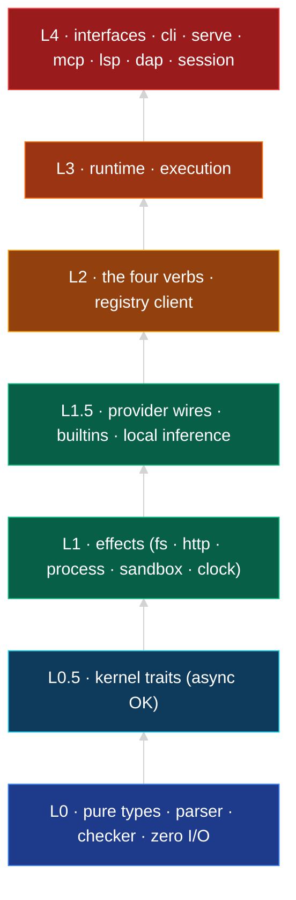

import { STATUS } from "/snippets/_status-snapshot.mdx";

You install one `nika` binary (or `@supernovae-st/nika` for apps). This page
explains why that binary can `check` a file before it runs. Workflow authors
never pick a layer: this is how the engine is built, not how you use it.

Internally the engine is a Rust workspace of {STATUS.cratesWorkspace} crates
at v{STATUS.version}: {STATUS.cratesAdmitted} admitted past the twelve
[admission gates](/architecture/admission), and
{STATUS.wipCrates.length} still pre-admission, several of which ship in the
binary (the Session, the terminal workspace, `nika serve`). Each crate has one
job. Together they parse `.nika`, check it, route to providers, execute verbs
and record the run.

<Tip>
  **Looking for the authoritative contract?** The [Architecture tab](/architecture/layers)
  holds it: [layers](/architecture/layers) ·
  [forward-compatibility invariants](/architecture/forward-compat-invariants) ·
  [L0 decisions](/architecture/l0-decisions) · [admission](/architecture/admission).
  This page orients; those pages are the record.
</Tip>

## Layers, bottom up

Arrows read "built on". L4 interface crates consume the L3 runtime, which
orchestrates the L2 verbs, which call L1 effects and L1.5 provider wires
through L0.5 kernel traits, which use L0 types. **An upward import fails CI.**
The `nika` binary is built from the `nika-cli` crate at L4; a separate L5
composition root is not built.

## Each layer answers one question

| Layer | Question | Examples at v{STATUS.version} |
|---|---|---|
| **L0** | What shapes does the engine use, and what does a file mean? | `nika-types`, `nika-error`, `nika-event`, `nika-schema`, `nika-check`, `nika-cel`, `nika-catalog` |
| **L0.5** | What contract does a provider, filesystem, clock or tool executor implement? | `nika-kernel` (a facade over `nika-kernel-core`, `-ai`, `-runtime`, `-plugin`), `nika-kernel-mock` |
| **L1** | How do I read a file, call a host, run a process safely? | `nika-fs`, `nika-http`, `nika-exec-runner`, `nika-sandbox-seatbelt`, `nika-sandbox-landlock`, `nika-clock` |
| **L1.5** | How do I speak to a model provider, run a builtin, infer locally? | `nika-providers`, `nika-providers-access`, `nika-builtin`, `nika-extract`, `nika-infer-local` |
| **L2** | How do I execute a Nika verb end-to-end? | `nika-verb-infer`, `nika-verb-exec`, `nika-verb-invoke`, `nika-verb-agent` |
| **L3** | How do I orchestrate a whole workflow safely? | `nika-runtime`, `nika-runtime-laws`, `nika-execution` |
| **L4** | How does a person, tool or editor talk to Nika? | `nika-cli` (the binary), `nika-serve`, `nika-mcp`, `nika-lsp`, `nika-dap`, `nika-trace`, `nika-session` |

## Why layers matter

<AccordionGroup>
  <Accordion title="Mechanical sorting · no debate" icon="layer-group">
    New crate? Answer the [mechanical sort test](/architecture/layers#mechanical-sort-test)
    in under ten seconds. No meetings, no "where should this live".
  </Accordion>
  <Accordion title="Trustable L0 · no hidden I/O" icon="shield">
    L0 has **zero I/O, zero async, zero runtime dependencies**. The parser and
    the checker that `nika check` runs live there: the command line reads the
    file, and the judgment itself calls no model and performs no effect.
    Property tests against L0 types run in milliseconds.
  </Accordion>
  <Accordion title="Swappable effects · test hermetically" icon="rotate">
    Every I/O crate implements a kernel trait with a mock twin. Unit tests use
    `nika-kernel-mock` (`MockClock`, `MockFs`, `MockProvider`): no network, no
    disk, no wall-clock flakiness.
  </Accordion>
  <Accordion title="The runtime boundary · permits and the sandbox" icon="explosion">
    What a workflow may touch is declared in its `permits:` block and enforced
    at run time, with `exec:` children confined by the OS sandbox (Seatbelt on
    macOS, bubblewrap on Linux). Crates were also meant to declare capability
    axes in a registry; no CI check enforces that vocabulary in 0.123.2. See
    [Security](/concepts/security).
  </Accordion>
</AccordionGroup>

## The build model

A crate is admitted when it passes [twelve gates](/architecture/admission):
specification first, tests red before code, zero clippy warnings, mutation
testing, property tests where they matter, benchmarks on hot paths, clean
docs, a canary workflow, a review, and one atomic commit. Pre-admission crates
can live in the workspace, and ship, while they work towards those gates;
`Cargo.toml` lists them.

After 0.123 the engine is maintained: security fixes, bug fixes and
compatibility. No new crate admissions are planned.

[The crate constellation →](/reference/constellation) · [Admission →](/architecture/admission)

## See also

<CardGroup cols={2}>
  <Card title="Layers" icon="layer-group" href="/architecture/layers">
    The layer registry and the mechanical sort test.
  </Card>
  <Card title="Forward-compat invariants" icon="shield-halved" href="/architecture/forward-compat-invariants">
    The patterns that keep the public API stable.
  </Card>
  <Card title="L0 decisions" icon="list-check" href="/architecture/l0-decisions">
    The early foundation decisions and what became of them.
  </Card>
  <Card title="Admission" icon="check-double" href="/architecture/admission">
    The twelve gates with their rationale.
  </Card>
</CardGroup>
