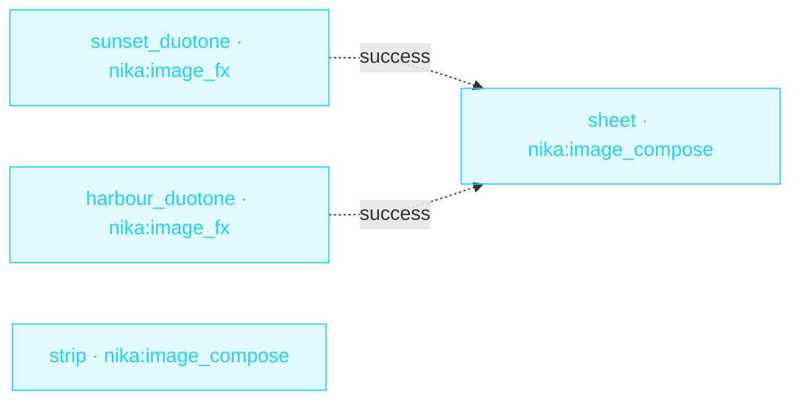

> **T2 chain · creators / media**: `nika:image_fx` makes a duotone twin of
> each sample photo, then `nika:image_compose` lays the two photos side by
> side and the four images out as a 2×2 contact sheet. No model, no image
> program to install, no network: the same photos give the same sheet, byte
> for byte, on the same pinned engine.

{/* TODO(release 0.124.0): the managed blocks below were projected from
    nika-spec ebc6448; re-project every example at the tag's SPEC_PIN, and
    move the fixture URL to the v0.124.0 tag with the other example pages. */}

## The job

A contact sheet used to mean a round trip through an image editor, or an
`exec:` call to an image program, with a shell boundary to grant and a tool to
install. Here the sheet is a builtin call: the layout is written once in
YAML, every input is a read the check judges, and the result carries its own
recipe.

## The shape

{/* showcase:dag-begin image-compose-sheet.nika */}

{/* showcase:dag-end */}

## The file

{/* showcase:begin image-compose-sheet.nika */}
```yaml image-compose-sheet.nika
nika: image-compose-sheet

permits:
  exec: false
  tools: ["nika:image_compose", "nika:image_fx"]
  fs:
    # Exact files, read and written: the photos ship with the repo, and the
    # sheet also reads back the two duotones this file writes.
    read:
      - "examples/fixtures/photos/harbour-02.png"
      - "examples/fixtures/photos/sunset-01.png"
      - "out/contact/harbour-duotone.png"
      - "out/contact/sunset-duotone.png"
    write:
      - "out/contact/harbour-duotone.png"
      - "out/contact/sheet.png"
      - "out/contact/strip.png"
      - "out/contact/sunset-duotone.png"

tasks:
  sunset_duotone:
    invoke:
      tool: "nika:image_fx"
      args:
        input: "examples/fixtures/photos/sunset-01.png"
        out: "out/contact/sunset-duotone.png"
        ops: [ { duotone: { dark: "#10141c", light: "#f2c14e" } } ]

  harbour_duotone:
    invoke:
      tool: "nika:image_fx"
      args:
        input: "examples/fixtures/photos/harbour-02.png"
        out: "out/contact/harbour-duotone.png"
        ops: [ { duotone: { dark: "#10141c", light: "#7fd1ff" } } ]

  # Two photos side by side, each at its own size.
  strip:
    invoke:
      tool: "nika:image_compose"
      args:
        inputs:
          - "examples/fixtures/photos/sunset-01.png"
          - "examples/fixtures/photos/harbour-02.png"
        out: "out/contact/strip.png"
        layout: row
        gap: 4
        background: "#10141c"

  # The sheet reads the duotones, so it runs after both land.
  sheet:
    after: { sunset_duotone: success, harbour_duotone: success }
    invoke:
      tool: "nika:image_compose"
      args:
        inputs:
          - "examples/fixtures/photos/sunset-01.png"
          - "out/contact/sunset-duotone.png"
          - "examples/fixtures/photos/harbour-02.png"
          - "out/contact/harbour-duotone.png"
        out: "out/contact/sheet.png"
        scale: fit
        cell: { width: 96, height: 64 }
        gap: 4
        padding: 8
        background: "#10141c"

outputs:
  strip:
    value: ${{ tasks.strip.output }}
    description: "The side-by-side receipt · path, sha256, width and height"
  sheet:
    value: ${{ tasks.sheet.output }}
    description: "The contact-sheet receipt · path, sha256, width and height"
```
{/* showcase:end */}

## Two things this file teaches

1. **Every input is a read, every sheet a write.** The `permits:` block names
   the exact files: the two photos and the two duotones the sheet reads back,
   and the four files the run writes. `nika check` judges each literal input
   of `nika:image_compose` against `permits.fs.read` before anything runs, so
   a missing grant is a check-time `NIKA-SEC-004`, not a surprise at run.
2. **The sheet waits for what it reads.** `sheet` reads the duotones that
   `sunset_duotone` and `harbour_duotone` write, so `after:` orders it behind
   both. `strip` reads only the photos, so it runs in the first wave.

## Run it

<Note>
  **What it needs:** The two sample PNG files. No model, no key, no network.
</Note>

<Steps>
  <Step title="Rehearse it">
    ```bash
    nika try image-compose-sheet
    ```

    The sample files come with it and nothing is written in your folder.
  </Step>
  <Step title="Get your own copy">
    Save the file above as `image-compose-sheet.nika` in a new folder, then download the samples it reads:

    ```bash
    FIXTURES=https://raw.githubusercontent.com/supernovae-st/nika/v0.123.2/crates/nika-pack/pack/examples/fixtures
    mkdir -p examples/fixtures/photos
    curl -fsSLo examples/fixtures/photos/sunset-01.png "$FIXTURES/photos/sunset-01.png"
    curl -fsSLo examples/fixtures/photos/harbour-02.png "$FIXTURES/photos/harbour-02.png"
    ```
  </Step>
  <Step title="Check it, then run it">
    ```bash
    nika check image-compose-sheet.nika
    nika run image-compose-sheet.nika
    ```

    The run writes the two duotones, `out/contact/strip.png` and
    `out/contact/sheet.png`. Each sheet's output carries its path, sha256,
    width and height; run it again and identical bytes already at `out:` are
    an idempotent skip.
  </Step>
</Steps>
