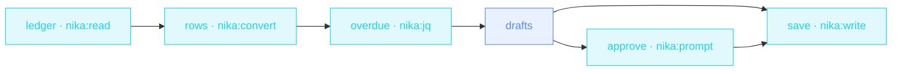

> **T2 chain · finance / freelance**: the human-in-the-loop example.
> `nika:prompt` blocks the workflow until someone answers; the
> drafting is automated, the **sending decision never is**.

## The job

Friday: open the ledger, find who's late, write polite-but-firm
reminders, don't send the awkward one to the client who paid this
morning. This file filters the CSV deterministically (jq, not an LLM
guessing at numbers), drafts every reminder, then stops and asks you.

## The shape

{/* showcase:dag-begin invoice-chaser.nika */}

{/* showcase:dag-end */}

## The file

{/* showcase:begin invoice-chaser.nika */}
```yaml invoice-chaser.nika
nika: invoice-chaser

model: ollama/qwen3.5:4b   # local · zero key · swap for groq/llama-3.3-70b-versatile (drafting is a fast-model job)

const:
  ledger_csv: "examples/fixtures/invoices.csv"
permits:
  tools: ["nika:convert", "nika:jq", "nika:prompt", "nika:read", "nika:write"]
  fs:
    # Two files, both spelled out — `const.ledger_csv` in, the drafts file
    # out. A const is baked in and a run cannot move it, so the boundary is
    # exact: no glob, and nothing else on disk is reachable either way.
    read: ["examples/fixtures/invoices.csv"]
    write: ["out/reminders-to-send.md"]

tasks:
  ledger:
    invoke:
      tool: "nika:read"
      args: { path: "${{ const.ledger_csv }}" }

  rows:
    with:
      csv: ${{ tasks.ledger.output }}
    invoke:
      tool: "nika:convert"
      args:
        input: "${{ with.csv }}"
        from: csv
        to: json
        has_header: true

  overdue:
    with:
      rows: ${{ tasks.rows.output }}
    invoke:
      tool: "nika:jq"
      args:
        input: "${{ with.rows }}"
        expression: 'map(select(.status == "overdue"))'

  drafts:
    with:
      overdue: ${{ tasks.overdue.output }}
    when: ${{ size(with.overdue) > 0 }}
    infer:
      # a reasoning model needs 16384 here, or a documented run.reasoning.effort: low
      max_tokens: 900       # a ceiling makes the cost report a number, not UNBOUNDED
      prompt: |
        Draft one short, polite payment reminder email per overdue invoice ·
        ${{ with.overdue }}
        Markdown · one section per client · firm but warm.

  approve:
    with:
      drafts: ${{ tasks.drafts.output }}
    when: ${{ with.drafts != null && size(with.drafts) > 0 }}   # nothing drafted — OR an empty answer (a thinking seat can spend the budget in its think block) · nothing to approve
    invoke:
      tool: "nika:prompt"
      args:
        message: "Save the reminder drafts for sending?"
        default: false

  save:
    with:
      drafts: ${{ tasks.drafts.output }}
      approved: ${{ tasks.approve.output }}
    when: ${{ with.drafts != null && size(with.drafts) > 0 && with.approved == true }}   # skipped (null) OR empty drafts → never write a 0-byte deliverable under a green run
    invoke:
      tool: "nika:write"
      args:
        path: out/reminders-to-send.md
        create_dirs: true
        content: "${{ with.drafts }}"

outputs:
  overdue:
    value: ${{ tasks.overdue.output }}
    description: "The overdue rows the reminders were drafted for"
```
{/* showcase:end */}

## How it works

<Steps>
  <Step title="Data work is jq work">
    CSV → JSON via `nika:convert`, then `map(select(.status == "overdue"))`
    in `nika:jq`. No model touches the numbers: deterministic, free,
    auditable.
  </Step>
  <Step title="size() gates the whole tail">
    The list crosses the boundary (`overdue: ${{ tasks.overdue.output }}`
    in `with:`), then `when: ${{ size(with.overdue) > 0 }}` is the
    canonical empty-check. No overdue invoices → the rest of the file
    skips (and value edges pass the skip along as `null`).
  </Step>
  <Step title="The approval gate">
    `nika:prompt` asks at a terminal; with no terminal it takes its
    `default: false`, so a script or a scheduler never sends anything by
    accident. The save binds the verdict
    (`approved: ${{ tasks.approve.output }}`) and runs only
    `when: ${{ with.drafts != null && size(with.drafts) > 0 && with.approved == true }}`.
  </Step>
</Steps>

## Constructs you just used

| Construct | Where | Reference |
|---|---|---|
| `nika:convert` from/to | `rows` | [Builtins](/reference/builtins) |
| `nika:jq` filtering | `overdue` | [Builtins](/reference/builtins) |
| CEL `size()` | `drafts.when` | [Workflows](/concepts/workflows) |
| `nika:prompt` human gate | `approve` | [Builtins](/reference/builtins) |

## Run it

<Note>
  **What it needs:** A local model ([Ollama](https://ollama.com) serving `qwen3.5:4b`) and the sample ledger: three of its five rows are overdue, so the run reaches the gate.
</Note>

<Steps>
  <Step title="Rehearse it">
    ```bash
    nika try invoice-chaser
    ```

    A mock model answers, the sample files come with it, and nothing is written in your folder.
  </Step>
  <Step title="Get your own copy">
    Save the file above as `invoice-chaser.nika` in a new folder, then download the sample it reads:

    ```bash
    FIXTURES=https://raw.githubusercontent.com/supernovae-st/nika/v0.123.1/crates/nika-pack/pack/examples/fixtures
    mkdir -p examples/fixtures
    curl -fsSLo examples/fixtures/invoices.csv "$FIXTURES/invoices.csv"
    ```
  </Step>
  <Step title="Check it, then run it">
    ```bash
    nika check invoice-chaser.nika
    nika run invoice-chaser.nika --model mock/echo   # a mock model, no key
    ollama pull qwen3.5:4b   # once, for the real run
    nika run invoice-chaser.nika
    ```

    The run writes `out/reminders-to-send.md`, once you approve.

    Any other model works: pass `--model <provider>/<name>` with its key, and cap a cloud model with `--max-cost-usd`.

    On a terminal the gate asks you. Piped, in CI or under a scheduler it takes `default: false` and skips the write.
  </Step>
</Steps>

## Make it yours

- Per-client emails instead of one file: `for_each` over the overdue rows ([fan-out tier](/examples/competitor-radar)).
- Escalate 60-days-late differently: a second jq filter + a sterner prompt.
- Wire the approved drafts to your mail API with `nika:fetch method: POST`.

<Card title="Next · Support triage" icon="headset" href="/examples/support-triage">
  Classify a whole queue in one schema-typed call, then let jq slice the
  urgent ones out.
</Card>
