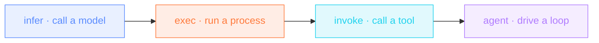

import { CANON } from "/snippets/_canon.mdx";

Start with [offline examples](/examples/offline): known inputs, exact
outputs, no provider key and no external services. The broader gallery
contains workflows with their own model, file and service requirements.
Inspect those prerequisites and permissions before running them.

The binary also includes a rehearsal gallery:

```bash
nika try 01-hello                    # the mock rehearsal · zero keys · nothing written
nika compile hello hello.nika        # write the offline lesson at an explicit destination
```

`nika try` previews an example on the mock model with zero setup: zero keys
and no model call. The mock replaces the model, not the network: an example
that fetches still reaches its host, and `nika try` names those hosts
(`may reach: …`) before the run. `nika compile`
writes only a Ready candidate to an explicit destination; showcase jobs
on these pages are copied from the YAML, not instantiated by a showcase
slug. `nika compile --list` names exact skeletons. Unknown intent stays
incomplete and does not pick a substitute.

<video
  autoPlay
  muted
  loop
  playsInline
  controls
  className="w-full aspect-video rounded-xl"
  poster="/images/posters/workflow-gallery.png"
  aria-label="The gallery nika try lists: a numbered learning path and a shelf of ready-made jobs"
  alt="The gallery nika try lists: a numbered learning path and a shelf of ready-made jobs"
>
  <source src="/videos/workflow-gallery.webm" type="video/webm" />
  <source src="/videos/workflow-gallery.mp4" type="video/mp4" />
</video>
<p className="mt-2 text-sm text-center opacity-80">**Start from a workflow.** Run `nika try` with no argument to see the gallery built into the binary: a numbered learning path and a shelf of ready-made jobs, each marked with the verbs it uses. `nika try <name>` previews one on the mock model. *The listing is captured from the real CLI on nika 0.121.0.*</p>

The YAML you read here is projected verbatim from
[`nika-spec/examples/`](https://github.com/supernovae-st/nika-spec/tree/main/examples),
where each file passes the same conformance gate as the spec's own test
suite. That validates the file against that contract; it does not prove
that an external integration is configured or that a model will produce
a useful result. A mock rehearsal proves neither a live integration nor
an AI answer.

Together with the numbered learning path that `nika try` lists, these
workflows exercise **all {CANON.builtins} builtins** and the
{CANON.verbs} verbs. Each job page ends with a **Run it** section: the
mock rehearsal, the sample files to download, and what the real run needs.

## How to read a workflow diagram

Tasks are colored by verb, the same palette everywhere in the Nika
universe:



## T1 · Starters

Small files: one chain, one diamond or one small fan-out. You can run one
of these in your first five minutes.

<Columns cols={2}>
  <Card title="Standup digest" icon="sunrise" href="/examples/standup-digest">
    **Engineering**: your standup note, written from what you actually
    committed yesterday.
  </Card>
  <Card title="Meeting actions" icon="list-check" href="/examples/meeting-actions">
    **Every office**: transcript in, tracker-ready typed action items
    out.
  </Card>
  <Card title="Price watch" icon="tag" href="/examples/price-watch">
    **E-commerce**: a price-drop alert with zero model calls.
  </Card>
  <Card title="OG images" icon="image" href="/examples/og-images">
    **Marketing**: brief in, OG variants on disk + a provenance
    manifest out — offline-testable with the mock provider.
  </Card>
  <Card title="Social repurpose" icon="share-nodes" href="/examples/social-repurpose">
    **Marketing**: one post becomes a thread, a LinkedIn post and a
    newsletter blurb, in parallel.
  </Card>
  <Card title="Local-first daily brief" icon="house-signal" href="/examples/local-first-daily-brief">
    **Local-first**: a real fetch, a local model and a verifiable trace,
    with no key anywhere.
  </Card>
  <Card title="Image FX batch" icon="wand-magic-sparkles" href="/examples/image-fx-batch">
    **Creators / Media**: a folder of photos to deterministic art. No
    model, no network.
  </Card>
  <Card title="Remove an owned file" icon="trash-can" href="/examples/remove-owned-file">
    **Any team**: write a scratch file, then remove exactly that file and
    never one the workflow did not create.
  </Card>
</Columns>

## T2 · Chains

Chains of a handful of tasks: structured outputs, human gates, and the
data builtins start pulling their weight.

<Columns cols={2}>
  <Card title="Release notes" icon="rocket" href="/examples/release-notes">
    **Engineering / DevRel**: git log → typed notes → CHANGELOG edited
    in place → team pinged.
  </Card>
  <Card title="SEO content brief" icon="magnifying-glass-chart" href="/examples/seo-content-brief">
    **SEO / Content**: a brief grounded in what your competitor
    actually published.
  </Card>
  <Card title="Invoice chaser" icon="file-invoice-dollar" href="/examples/invoice-chaser">
    **Finance / Freelance**: reminders drafted, and NOTHING goes out
    until a human says yes.
  </Card>
  <Card title="Support triage" icon="headset" href="/examples/support-triage">
    **Customer support**: the overnight queue classified, first replies
    drafted, urgent ones escalated.
  </Card>
  <Card title="Contract guard" icon="scale-balanced" href="/examples/contract-guard">
    **Legal**: clause extraction on a LOCAL model. The contract never
    leaves the machine.
  </Card>
  <Card title="ETL quarantine" icon="filter" href="/examples/etl-quarantine">
    **Data engineering**: bad batches degrade to a quarantine file
    instead of killing the pipeline.
  </Card>
  <Card title="Release radar" icon="signal" href="/examples/release-radar">
    **DevOps**: dependency feeds diffed against last run. Only the
    NEW ships reach you.
  </Card>
  <Card title="Model bench" icon="scale-unbalanced" href="/examples/model-bench">
    **Engineering**: the same question, three local models, one measured
    table.
  </Card>
  <Card title="CSV chart report" icon="chart-column" href="/examples/csv-chart-report">
    **Data**: a CSV becomes a chart and a one-page report. No model.
  </Card>
  <Card title="Contact sheet" icon="table-cells" href="/examples/image-compose-sheet">
    **Creators / Media**: photos and their duotone twins become one contact
    sheet. No model, no image program, no network.
  </Card>
  <Card title="Transcript show-notes" icon="podcast" href="/examples/transcript-shownotes">
    **Podcasts / Meetings**: a raw transcript becomes typed chapters,
    quotes and a summary in one bounded call.
  </Card>
  <Card title="Bookmark triage" icon="bookmark" href="/examples/bookmark-triage">
    **Research**: a pile of saved URLs becomes one table, dead links
    included.
  </Card>
</Columns>

## T3 · Fan-out

`for_each` over collections the workflow discovers at runtime, with
retry, bounded parallelism and jq fan-ins.

<Columns cols={2}>
  <Card title="Competitor radar" icon="satellite-dish" href="/examples/competitor-radar">
    **Strategy / PMM**: everything they shipped last week, read in parallel,
    one Monday brief.
  </Card>
  <Card title="Localization factory" icon="language" href="/examples/localization-factory">
    **Product / i18n**: the whole docs tree translated, voice intact,
    zero copy-paste.
  </Card>
  <Card title="Config drift sentinel" icon="shield-halved" href="/examples/config-drift-sentinel">
    **SRE / Platform**: only unsanctioned prod drift wakes anyone. jq
    decides; the model explains.
  </Card>
  <Card title="PR review fan-out" icon="code-pull-request" href="/examples/pr-review-fanout">
    **Engineering**: a read-only review agent per changed file. A
    swarm with a leash.
  </Card>
  <Card title="Resume screener" icon="user-check" href="/examples/resume-screener">
    **HR / Recruiting**: one local-model rubric per candidate, ranked
    deterministically. PII stays home.
  </Card>
</Columns>

## T4 · Epic

Multi-stage pipelines: agents under budget, human gates, runs that
report on themselves.

<Columns cols={2}>
  <Card title="Deep research brief" icon="microscope" href="/examples/deep-research-brief">
    **Research / VC**: plan → budgeted research agent → synthesis.
    Auditable end to end.
  </Card>
  <Card title="Corpus digest" icon="layer-group" href="/examples/corpus-digest">
    **Research**: a pile of documents becomes one sourced brief, and no
    model window ever holds two of them.
  </Card>
  <Card title="Incident war room" icon="fire-extinguisher" href="/examples/incident-war-room">
    **SRE / On-call**: evidence in parallel, a typed timeline, and a
    recovery check before the draft.
  </Card>
  <Card title="CEO Monday brief" icon="briefcase" href="/examples/ceo-monday-brief">
    **Founders / Execs**: market, engineering pulse and KPIs gathered
    behind one human decision, one dated brief.
  </Card>
  <Card title="Release train" icon="train" href="/examples/release-train">
    **DevOps / Release**: parallel gates, a human GO, a hold until the
    window. Time as a first-class citizen.
  </Card>
</Columns>

## Find the example that teaches X

Looking for one construct? This index is generated from the workflow
files, so it cannot go stale.

{/* showcase:coverage-begin */}
| Construct | Taught by |
|---|---|
| [fan-out over a collection](/concepts/workflows) | [bookmark-triage](/examples/bookmark-triage) · [competitor-radar](/examples/competitor-radar) · [corpus-digest](/examples/corpus-digest) · [image-fx-batch](/examples/image-fx-batch) · [localization-factory](/examples/localization-factory) · [pr-review-fanout](/examples/pr-review-fanout) · [resume-screener](/examples/resume-screener) |
| [bounded concurrency](/concepts/workflows) | [bookmark-triage](/examples/bookmark-triage) · [competitor-radar](/examples/competitor-radar) · [corpus-digest](/examples/corpus-digest) · [image-fx-batch](/examples/image-fx-batch) · [localization-factory](/examples/localization-factory) · [pr-review-fanout](/examples/pr-review-fanout) · [resume-screener](/examples/resume-screener) |
| [collect-errors batches](/concepts/workflows) | [bookmark-triage](/examples/bookmark-triage) · [competitor-radar](/examples/competitor-radar) · [corpus-digest](/examples/corpus-digest) · [localization-factory](/examples/localization-factory) · [pr-review-fanout](/examples/pr-review-fanout) · [resume-screener](/examples/resume-screener) |
| [CEL conditional gate](/concepts/workflows) | [ceo-monday-brief](/examples/ceo-monday-brief) · [competitor-radar](/examples/competitor-radar) · [config-drift-sentinel](/examples/config-drift-sentinel) · [corpus-digest](/examples/corpus-digest) · [etl-quarantine](/examples/etl-quarantine) · [incident-war-room](/examples/incident-war-room) · [invoice-chaser](/examples/invoice-chaser) · [pr-review-fanout](/examples/pr-review-fanout) · [price-watch](/examples/price-watch) · [release-notes](/examples/release-notes) · [release-radar](/examples/release-radar) · [release-train](/examples/release-train) · [resume-screener](/examples/resume-screener) · [support-triage](/examples/support-triage) |
| [transient-error retry](/reference/error-codes) | [bookmark-triage](/examples/bookmark-triage) · [competitor-radar](/examples/competitor-radar) · [config-drift-sentinel](/examples/config-drift-sentinel) · [incident-war-room](/examples/incident-war-room) · [release-train](/examples/release-train) |
| [task time-bound](/concepts/workflows) | [competitor-radar](/examples/competitor-radar) · [corpus-digest](/examples/corpus-digest) · [release-train](/examples/release-train) |
| [fallback recovery](/reference/error-codes) | [bookmark-triage](/examples/bookmark-triage) · [ceo-monday-brief](/examples/ceo-monday-brief) · [competitor-radar](/examples/competitor-radar) · [config-drift-sentinel](/examples/config-drift-sentinel) · [corpus-digest](/examples/corpus-digest) · [etl-quarantine](/examples/etl-quarantine) · [incident-war-room](/examples/incident-war-room) · [localization-factory](/examples/localization-factory) · [pr-review-fanout](/examples/pr-review-fanout) · [price-watch](/examples/price-watch) · [release-notes](/examples/release-notes) · [release-radar](/examples/release-radar) · [resume-screener](/examples/resume-screener) · [seo-content-brief](/examples/seo-content-brief) · [standup-digest](/examples/standup-digest) |
| [the data boundary · bindings ARE edges](/concepts/bindings) | [bookmark-triage](/examples/bookmark-triage) · [ceo-monday-brief](/examples/ceo-monday-brief) · [competitor-radar](/examples/competitor-radar) · [config-drift-sentinel](/examples/config-drift-sentinel) · [contract-guard](/examples/contract-guard) · [corpus-digest](/examples/corpus-digest) · [csv-chart-report](/examples/csv-chart-report) · [deep-research-brief](/examples/deep-research-brief) · [etl-quarantine](/examples/etl-quarantine) · [image-fx-batch](/examples/image-fx-batch) · [incident-war-room](/examples/incident-war-room) · [invoice-chaser](/examples/invoice-chaser) · [localization-factory](/examples/localization-factory) · [meeting-actions](/examples/meeting-actions) · [model-bench](/examples/model-bench) · [pr-review-fanout](/examples/pr-review-fanout) · [price-watch](/examples/price-watch) · [release-notes](/examples/release-notes) · [release-radar](/examples/release-radar) · [release-train](/examples/release-train) · [resume-screener](/examples/resume-screener) · [seo-content-brief](/examples/seo-content-brief) · [social-repurpose](/examples/social-repurpose) · [standup-digest](/examples/standup-digest) · [support-triage](/examples/support-triage) · [transcript-shownotes](/examples/transcript-shownotes) |
| [jq extraction bindings](/concepts/bindings) | [ceo-monday-brief](/examples/ceo-monday-brief) · [price-watch](/examples/price-watch) · [release-radar](/examples/release-radar) · [seo-content-brief](/examples/seo-content-brief) |
| [typed (structured) output](/concepts/verbs) | [contract-guard](/examples/contract-guard) · [corpus-digest](/examples/corpus-digest) · [deep-research-brief](/examples/deep-research-brief) · [incident-war-room](/examples/incident-war-room) · [meeting-actions](/examples/meeting-actions) · [pr-review-fanout](/examples/pr-review-fanout) · [release-notes](/examples/release-notes) · [resume-screener](/examples/resume-screener) · [seo-content-brief](/examples/seo-content-brief) · [support-triage](/examples/support-triage) · [transcript-shownotes](/examples/transcript-shownotes) |
| [masked secret references](/reference/yaml-syntax) | [ceo-monday-brief](/examples/ceo-monday-brief) · [config-drift-sentinel](/examples/config-drift-sentinel) · [incident-war-room](/examples/incident-war-room) · [price-watch](/examples/price-watch) · [release-notes](/examples/release-notes) · [support-triage](/examples/support-triage) |
| [typed workflow inputs](/reference/yaml-syntax) | [ceo-monday-brief](/examples/ceo-monday-brief) · [competitor-radar](/examples/competitor-radar) · [config-drift-sentinel](/examples/config-drift-sentinel) · [contract-guard](/examples/contract-guard) · [corpus-digest](/examples/corpus-digest) · [deep-research-brief](/examples/deep-research-brief) · [incident-war-room](/examples/incident-war-room) · [meeting-actions](/examples/meeting-actions) · [release-notes](/examples/release-notes) · [release-train](/examples/release-train) · [seo-content-brief](/examples/seo-content-brief) |
| [typed workflow outputs (callable)](/reference/yaml-syntax) | [bookmark-triage](/examples/bookmark-triage) · [ceo-monday-brief](/examples/ceo-monday-brief) · [competitor-radar](/examples/competitor-radar) · [config-drift-sentinel](/examples/config-drift-sentinel) · [contract-guard](/examples/contract-guard) · [corpus-digest](/examples/corpus-digest) · [csv-chart-report](/examples/csv-chart-report) · [deep-research-brief](/examples/deep-research-brief) · [etl-quarantine](/examples/etl-quarantine) · [image-compose-sheet](/examples/image-compose-sheet) · [image-fx-batch](/examples/image-fx-batch) · [incident-war-room](/examples/incident-war-room) · [invoice-chaser](/examples/invoice-chaser) · [localization-factory](/examples/localization-factory) · [meeting-actions](/examples/meeting-actions) · [model-bench](/examples/model-bench) · [og-images](/examples/og-images) · [pr-review-fanout](/examples/pr-review-fanout) · [price-watch](/examples/price-watch) · [release-notes](/examples/release-notes) · [release-radar](/examples/release-radar) · [release-train](/examples/release-train) · [remove-owned-file](/examples/remove-owned-file) · [resume-screener](/examples/resume-screener) · [seo-content-brief](/examples/seo-content-brief) · [social-repurpose](/examples/social-repurpose) · [standup-digest](/examples/standup-digest) · [support-triage](/examples/support-triage) · [transcript-shownotes](/examples/transcript-shownotes) |
| [default-deny tool grants](/concepts/verbs) | [deep-research-brief](/examples/deep-research-brief) · [pr-review-fanout](/examples/pr-review-fanout) |
| [local inference](/concepts/providers) | [ceo-monday-brief](/examples/ceo-monday-brief) · [competitor-radar](/examples/competitor-radar) · [config-drift-sentinel](/examples/config-drift-sentinel) · [contract-guard](/examples/contract-guard) · [corpus-digest](/examples/corpus-digest) · [deep-research-brief](/examples/deep-research-brief) · [incident-war-room](/examples/incident-war-room) · [invoice-chaser](/examples/invoice-chaser) · [localization-factory](/examples/localization-factory) · [meeting-actions](/examples/meeting-actions) · [pr-review-fanout](/examples/pr-review-fanout) · [release-notes](/examples/release-notes) · [release-radar](/examples/release-radar) · [resume-screener](/examples/resume-screener) · [seo-content-brief](/examples/seo-content-brief) · [social-repurpose](/examples/social-repurpose) · [standup-digest](/examples/standup-digest) · [support-triage](/examples/support-triage) · [transcript-shownotes](/examples/transcript-shownotes) |
{/* showcase:coverage-end */}

## The rules every example obeys

- **One verb per task** · `infer`, `exec`, `invoke` or `agent`.
- **The binding IS the edge** · `${{ tasks.X.* }}` lives in `with:`
  (data) — each reference declares a typed edge — and `after:` orders on
  state. The DAG has no invisible edges, and the body reads
  `${{ with.<name> }}`, never `tasks.*` (`NIKA-VAR-021`).
- **Local by default** · a showcase that calls a model names a local
  Ollama model (`ollama/qwen3.5:4b` for most): zero API keys, inference
  stays on your machine. Cloud providers appear only as swap hints, never
  as the default.
- **Projection, not copy-paste** · these pages and the
  [nika.sh use cases](https://nika.sh/use-cases) render the same spec
  files, projected by the spec's `showcase-projector.py`; nobody edits
  the copies by hand.

Repeat an AI task every week? Describe it in the
[terminal Session](/getting-started/session) and keep the `.nika` file it
writes.

<Card title="Write your first workflow" icon="pen" href="/getting-started/first-workflow">
  Ready to write your own? Start from the guided first-workflow walk.
</Card>
