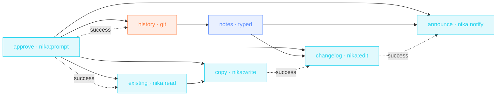

> **T2 chain · engineering / devrel**: the release-day ritual as one
> file: history in, a typed notes object out, a working copy of the
> CHANGELOG edited **in place** with `nika:edit`, the team pinged with the
> headline, all behind one human decision.

## The job

Every release someone copy-pastes git log into a doc, rewrites it, pastes
it into the CHANGELOG, then announces it. Four manual steps, four chances
to drift. Here the git range is one constant, a single gate asks before
anything runs, the notes are a schema-typed object, and the announcement
quotes the same headline the CHANGELOG got.

<Warning>
  **Limit on macOS in 0.123.2.** The sandbox confines `exec: git` to the
  workflow's declared filesystem boundary, which grants no read of `.git`
  or of git's global configuration. The confined `git` exits with status
  128, even inside a real repository, so `history` recovers a notice that
  says so, and `notes` and `changelog` close on it while `announce` never
  runs: no notes are drafted. `--var rehearse=true` drafts them from the
  sample log in `const:`. See
  [Known limits](/changelog/known-limits#git-inside-a-workflow-is-refused-on-macos).
</Warning>

## The shape

{/* showcase:dag-begin release-notes.nika */}

{/* showcase:dag-end */}

## The file

{/* showcase:begin release-notes.nika */}
```yaml release-notes.nika
nika: release-notes

# The house seat — a THINKING model: the think block and the JSON both count
# against `max_tokens` (engine#428), so the notes ceiling below covers the
# reasoning AND the notes, not the notes alone.
model: ollama/qwen3.5:4b

inputs:
  announce:
    type: bool
    default: false
    description: "Actually send the team ping (needs TEAM_WEBHOOK_URL)"
  rehearse:
    type: bool
    default: false
    description: "Draft from const.sample_log instead of git: a rehearsal, never announced"

const:
  since_tag: "v0.80.0"
  changelog_src: "examples/fixtures/CHANGELOG.md" # point this at YOUR CHANGELOG.md
  changelog_out: "out/CHANGELOG.md"                        # the working copy this run edits
  # The rehearsal log · read only under --var rehearse=true, never as a
  # stand-in for a history git could not give.
  sample_log: |
    a1b2c3d feat(api): pagination cursors on every list endpoint
    d4e5f6a fix(auth): refresh tokens no longer rotate on read
    7g8h9i0 refactor(store): drop the legacy write path

secrets:
  team_webhook:
    source: env
    key: TEAM_WEBHOOK_URL
    egress:                       # sanction the one send · the secret IS the URL
      - to: "nika:notify"
        host_from_self: true
permits:
  exec: ["git"]                   # the ONE program this workflow may run
  tools: ["nika:edit", "nika:notify", "nika:prompt", "nika:read", "nika:write"]
  net:
    # `host_from_self:` above sanctions the FLOW (the secret may be the URL) —
    # it does not grant the capability. The host stays unknown at check, so it
    # is judged at RUN against this bound: name the announce host here or the
    # send is refused mid-run, after the tokens are already spent.
    http: ["hooks.slack.com"]
  fs:
    # The workflow never edits your changelog in place — it copies it and
    # edits the copy, so you move the result when the diff looks right.
    #
    # The working copy appears in BOTH lists, and that is not redundancy:
    # `nika:edit` reads the file before it writes it, so a write-only grant
    # is refused with NIKA-SEC-004 · outside permits.fs.read. Every in-place
    # builtin owes both halves.
    read: ["examples/fixtures/CHANGELOG.md", "out/CHANGELOG.md"]
    write: ["out/CHANGELOG.md"]

tasks:
  # The human gate (NEP-0002 · v2.2). `git log` output is UNTRUSTED content —
  # a hostile branch writes its own commit subjects — and this workflow pairs
  # it with a private `fs.read` and a webhook: the lethal trifecta, unless a
  # human dominates the path. The gate comes FIRST and BOTH roots hang off it
  # (`history` carries the untrusted content, `existing` carries the private
  # read); a gate on a sibling branch dominates nothing. And each root
  # CONSUMES the answer affirmatively (NEP-0020 — a bare `after:` admits the
  # refusal: it settles success with value false), the downstream null-guards
  # passing the « no » along the value edges. Non-interactive runs answer it
  # in one pass with `--answer approve=true`.
  approve:
    invoke:
      tool: "nika:prompt"
      args:
        mode: "confirm"
        message: "read the git history since ${{ const.since_tag }}, rewrite the changelog copy, and ping the team if announce is on?"

  history:
    after: { approve: success }
    with:
      go: ${{ tasks.approve.output }}
    when: ${{ with.go == true }}       # « no » at the gate → no history read at all
    exec:
      command: ["git", "log", "${{ const.since_tag }}..HEAD", "--oneline", "--no-merges"]
    on_error:
      # No such tag, not a repo, or a refused command (the macOS sandbox
      # refuses git inside this boundary): the value NAMES the failure. A
      # stand-in log here would be drafted by `notes`, written by `changelog`
      # and announced to the team as commits that never happened.
      recover: "git history unavailable: the command failed or was refused. No commit facts were collected."

  notes:
    with:
      # The log the notes are drafted from: git's own, or the rehearsal
      # sample when you ask for it. A refused gate skips `history` (null),
      # and the binding stays null, so the « no » still closes this task.
      # Quoted · the ternary's ` : ` would otherwise end a YAML key.
      log: '${{ tasks.history.output != null && inputs.rehearse == true ? const.sample_log : tasks.history.output }}'
    # a refused gate (null) · an empty log · or the notice that git could not be read: nothing to draft
    when: ${{ with.log != null && size(with.log) > 0 && !with.log.startsWith('git history unavailable') }}
    infer:
      # a reasoning model needs 16384 here, or a documented run.reasoning.effort: low
      max_tokens: 3000                 # think block + the notes JSON
      prompt: |
        Write release notes from these commits ·
        ${{ with.log }}
        Tone · plain, direct, no marketing fluff.
      schema:
        type: object
        additionalProperties: false
        required: [headline, body]
        properties:
          headline: { type: string }
          breaking: { type: array, items: { type: string } }
          body: { type: string }

  # Copy-then-edit · `nika:edit` is strictly in place and throws when `find:`
  # matches nothing (NIKA-BUILTIN-EDIT-001), so its target must exist and must
  # carry the anchor. Read yours, write the working copy, edit THAT.
  existing:
    after: { approve: success }
    with:
      go: ${{ tasks.approve.output }}
    when: ${{ with.go == true }}       # the same « no » closes the private-read branch
    invoke:
      tool: "nika:read"
      args: { path: "${{ const.changelog_src }}" }

  copy:
    with:
      go: ${{ tasks.approve.output }}
      existing: ${{ tasks.existing.output }}
    when: ${{ with.go == true && with.existing != null && size(with.existing) > 0 }}  # « no » at the gate · or an empty file: nothing to copy
    invoke:
      tool: "nika:write"
      args:
        path: "${{ const.changelog_out }}"
        content: "${{ with.existing }}"
        create_dirs: true
        overwrite: true

  # The whole `notes` value crosses, and is tested, before a field of it is
  # read: a skipped `notes` reads null, and stepping into null would fail
  # this task instead of closing it.
  changelog:
    with:
      go: ${{ tasks.approve.output }}
      notes: ${{ tasks.notes.output }}
    when: ${{ with.go == true && with.notes != null }}  # no notes drafted · nothing to write
    after:
      copy: success              # state, no data · the anchor is on disk before we edit
    invoke:
      tool: "nika:edit"
      args:
        path: "${{ const.changelog_out }}"
        find: "# Changelog"      # a LITERAL string · not a regex
        count: 1                 # the top anchor only · never every occurrence
        replace: |
          # Changelog

          ## ${{ const.since_tag }}..HEAD · ${{ with.notes.headline }}

          ${{ with.notes.body }}

  announce:
    with:
      go: ${{ tasks.approve.output }}
      notes: ${{ tasks.notes.output }}
    # OFF by default, and never for a rehearsal: the team hears about real commits only
    when: ${{ with.go == true && inputs.announce == true && inputs.rehearse == false && with.notes != null }}
    after:
      changelog: success
    invoke:
      tool: "nika:notify"
      args:
        channel: webhook
        target: "${{ secrets.team_webhook }}"
        message: "Release notes ready · ${{ with.notes.headline }}"
        severity: info

outputs:
  headline: ${{ tasks.notes.output.headline }}
  body: ${{ tasks.notes.output.body }}
```
{/* showcase:end */}

## How it works

<Steps>
  <Step title="One gate before anything runs">
    `approve` is a `nika:prompt` with no `default:`, at the root. `history`
    and `existing` re-read its answer (`when: ${{ with.go == true }}`), so a
    « no » reads nothing and writes nothing. The missing default is
    deliberate: a default would disarm the decision this file exists to
    gate.
  </Step>
  <Step title="The range is one constant">
    `history` runs `git log ${{ const.since_tag }}..HEAD` as an argv list.
    `since_tag` is a `const:`: the file owns it, so you edit
    `const.since_tag` for the next release. `--var since_tag=…` is refused,
    because the file declares only the `announce` and `rehearse` inputs.
  </Step>
  <Step title="Typed notes · headline + breaking + body">
    The schema means `headline` is a real field downstream: `changelog` and
    `announce` bind the whole `notes` value, test it, then read
    `with.notes.headline` in the CHANGELOG insert AND in the ping. One
    source, two consumers, no drift. When no notes were drafted, both close
    instead of stepping into a null.
  </Step>
  <Step title="Copy, then edit in place">
    `existing` reads your changelog and `copy` writes it to
    `out/CHANGELOG.md`. `nika:edit` then finds the `# Changelog` heading in
    that copy and replaces it with itself plus the new section, so the
    history below stays intact. An in-place builtin never touches a file the
    workflow did not create, and you review the copy before it lands.
  </Step>
</Steps>

## Constructs you just used

| Construct | Where | Reference |
|---|---|---|
| `nika:prompt` gate at the root | `approve` | [Builtins](/reference/builtins) |
| `exec:` argv with a `const:` interpolation | `history` | [The 4 verbs](/concepts/verbs) |
| `infer.schema:` | `notes` | [The 4 verbs](/concepts/verbs) |
| `nika:edit` find/replace | `changelog` | [Builtins](/reference/builtins) |
| `nika:notify` + `secrets:` | `announce` | [Builtins](/reference/builtins) |

## Run it

<Note>
  **What it needs:** A local model ([Ollama](https://ollama.com) serving `qwen3.5:4b`) and the sample changelog. History comes from Git: outside a repository that has the `const.since_tag` tag (and on macOS in 0.123.2 in any case, [Known limits](/changelog/known-limits#git-inside-a-workflow-is-refused-on-macos)), `history` recovers a notice and no notes are drafted; add `--var rehearse=true` to rehearse the chain on the sample log.
</Note>

<Steps>
  <Step title="Rehearse it">
    ```bash
    nika try release-notes
    ```

    A mock model answers, the sample files come with it, and nothing is written in your folder. Before it runs, `nika try` names the hosts a step may reach: `may reach: hooks.slack.com — the mock replaces the model, not the network`. It stops at the `approve` gate, as a real run does. The rehearsal folder holds no repository, so once the gate is answered no notes are drafted unless you add `--var rehearse=true`.
  </Step>
  <Step title="Get your own copy">
    Save the file above as `release-notes.nika` in a new folder, then download the sample it reads:

    ```bash
    FIXTURES=https://raw.githubusercontent.com/supernovae-st/nika/v0.124.0/crates/nika-pack/pack/examples/fixtures
    mkdir -p examples/fixtures
    curl -fsSLo examples/fixtures/CHANGELOG.md "$FIXTURES/CHANGELOG.md"
    ```
  </Step>
  <Step title="Check it, then run it">
    ```bash
    nika check release-notes.nika
    nika run release-notes.nika --model mock/echo --var rehearse=true   # a mock model, no key, the sample log
    ollama pull qwen3.5:4b   # once, for the real run
    nika run release-notes.nika
    ```

    The run writes `out/CHANGELOG.md`, a copy of the changelog
    `const.changelog_src` names, and edits it only when notes were drafted:
    from your history, or from the sample log under `--var rehearse=true`.

    It asks at the `approve` gate before anything else runs. On a terminal you answer; in a script it pauses (exit 4) and prints the `--resume` line that continues it, or you answer up front with `--answer approve=true`.

    Any other model works: pass `--model <provider>/<name>` with its key, and cap a cloud model with `--max-cost-usd`.

    The team ping needs `--var announce=true`, `TEAM_WEBHOOK_URL` and notes
    drafted from real history: it never fires for a rehearsal.
  </Step>
</Steps>

## Make it yours

- Flag breaking changes in the ping: `announce` already binds the whole `notes` value, so read `with.notes.breaking` there; binding `tasks.notes.output.breaking` would step into null when `notes` is skipped and fail the task. `breaking` is optional in the schema: add it to `required`, then add `size(with.notes.breaking) > 0` to `announce`'s `when:`. A `tasks.*` reference written straight into `when:` is refused (`NIKA-VAR-021`).
- Render a public version too: a second `infer` task with a "user-facing tone" prompt, writing `docs/changelog/`.

<Card title="Next · SEO content brief" icon="magnifying-glass-chart" href="/examples/seo-content-brief">
  Chained fetch extractions (sitemap mode, then article mode) and CEL
  indexing into a binding.
</Card>
