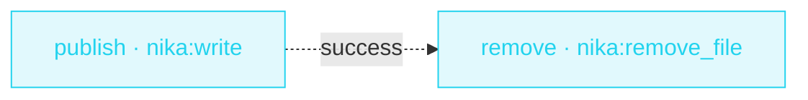

> **T1 starter · any team**: the smallest safe deletion. `nika:remove_file`
> removes one existing regular file by its exact path, with nothing
> recursive and nothing expanded, and only after this run's own write
> succeeded.

## The job

A job writes a scratch file, uses it, and should clean up after itself
without ever deleting something it did not create. This workflow writes
the scratch file with `overwrite: false`, then removes exactly that path
once the write has succeeded. If the path is already taken, the write
refuses, the removal never runs, and the file that was there survives.

## The shape

{/* showcase:dag-begin remove-owned-file.nika */}

{/* showcase:dag-end */}

## The file

{/* showcase:begin remove-owned-file.nika */}
```yaml remove-owned-file.nika
nika: remove-owned-file
permits:
  tools: ["nika:write", "nika:remove_file"]
  fs:
    write: ["./out/remove-owned-file/scratch.txt"]
tasks:
  publish:
    invoke:
      tool: "nika:write"
      args:
        path: "./out/remove-owned-file/scratch.txt"
        content: "temporary scratch content"
        overwrite: false
  remove:
    after: { publish: success }
    invoke:
      tool: "nika:remove_file"
      args: { path: "./out/remove-owned-file/scratch.txt" }
outputs:
  removed: ${{ tasks.remove.output }}
```
{/* showcase:end */}

## How it works

<Steps>
  <Step title="The write refuses to replace anything">
    `overwrite: false` makes `publish` fail when a file already sits at the
    path (`NIKA-BUILTIN-WRITE-002`). The workflow can create the scratch
    file; it cannot clobber one.
  </Step>
  <Step title="The removal waits for that write">
    `after: { publish: success }` is a state edge: `remove` runs only when
    this run's own write succeeded. When the path was taken, `remove` is
    blocked and the existing file stays where it was.
  </Step>
  <Step title="Removal is a write effect">
    `nika:remove_file` needs the tool grant and a `permits.fs.write` entry
    holding the exact path. It reads no content, so the file grants no
    `fs.read` at all. A missing name, a directory, a symlink or a special
    file fails; nothing is recursive, and no pattern is expanded.
  </Step>
</Steps>

<Note>
  This is not a transaction. If the removal fails after the write, the
  scratch file stays visible and nothing rolls back. The `removed` output
  is the path the run asked to remove, not a proof of what is on disk.
</Note>

## Constructs you just used

| Construct | Where | Reference |
|---|---|---|
| `nika:write` with `overwrite: false` | `publish` | [Builtins](/reference/builtins) |
| `after: { publish: success }` | `remove` | [Workflows](/concepts/workflows) |
| `nika:remove_file` | `remove` | [`nika:remove_file`](/reference/tools/remove_file) |
| `permits.fs.write` as the removal boundary | envelope | [Security](/concepts/security) |

## Run it

<Note>
  **What it needs:** Nothing: no model, no key, no network.
</Note>

<Steps>
  <Step title="Rehearse it">
    ```bash
    nika try remove-owned-file
    ```

    The rehearsal runs in a temporary folder; nothing is written in yours.
  </Step>
  <Step title="Check it, then run it">
    Save the file above as `remove-owned-file.nika`, then:

    ```bash
    nika check remove-owned-file.nika
    nika run remove-owned-file.nika --output json
    ```

    The run writes `out/remove-owned-file/scratch.txt`, removes it, and prints `{"removed":"./out/remove-owned-file/scratch.txt"}`.
  </Step>
</Steps>

## Make it yours

- Use your own scratch path: change both task paths and the
  `permits.fs.write` entry together. A permit is a literal, never an
  interpolation (`NIKA-AUTH-007`).
- Put the work that uses the scratch file between the two tasks, give it
  the `fs.read` grant it needs, and make `remove` wait for that task too.

<Card title="Level up · T2 chains" icon="rocket" href="/examples/release-notes">
  Next tier: typed outputs, in-place file edits and a webhook ping.
  Release day, automated.
</Card>
