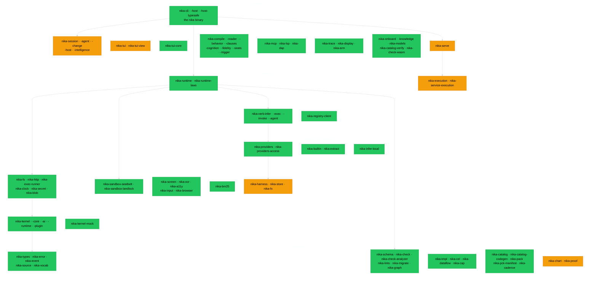

import { STATUS } from "/snippets/_status-snapshot.mdx";

This page is the **engine crate map**, not the getting-started path. You run
one `nika` binary; it already contains the CLI, the Session, `nika serve`,
`nika mcp`, `nika lsp` and `nika dap`. The TypeScript SDK is not a crate: it
is the npm package `@supernovae-st/nika`, in its own repository.

At v{STATUS.version} the engine is a Rust workspace of
**{STATUS.cratesWorkspace} crates** across the layers L0, L0.5, L1, L1.5, L2,
L3 and L4. **{STATUS.cratesAdmitted} are admitted** past the twelve
[admission gates](/architecture/admission); {STATUS.wipCrates.length} are
pre-admission ({STATUS.wipCrates.join(", ")}). Pre-admission crates are in
the released binary, the Session, the terminal workspace and `nika serve`
among them, while they work toward the gates. The workspace cap is
{STATUS.cratesCap} crates (ADR-037). In the 0.124 line, work stays focused on
maintenance, security and the media capabilities workflows need, with no new
crate planned.

<Tip>
  Layer model and enforcement: [Layers](/architecture/layers). Admission
  process: [Admission](/architecture/admission). The source of truth is the
  `[workspace.metadata.diamond]` table of the engine's
  [`Cargo.toml` at v0.123.0](https://github.com/supernovae-st/nika/blob/v0.123.0/Cargo.toml).
</Tip>

## The map

Green: admitted (twelve gates green). Amber: pre-admission, shipping in the binary. Each arrow is a real dependency at v0.123.0, a few of many: every workspace dependency points down a layer or stays within one, and `check-layering.sh` fails the build on an upward one.

## Layer by layer

| Layer | Admitted | Pre-admission | What lives here |
|---|---|---|---|
| **L4** | nika-cli, nika-cli-host, nika-cli-host-typesafe, nika-compile and its seven members (-behavior, -clauses, -cognition, -fidelity, -reader, -seats, -trigger), nika-tui-core, nika-mcp, nika-lsp, nika-dap, nika-trace, nika-display, nika-arm, nika-onboard, nika-onboard-knowledge, nika-models, nika-catalog-verify, nika-check-wasm | nika-session, nika-session-agent, nika-session-change, nika-session-host, nika-session-intelligence, nika-tui, nika-tui-view, nika-serve | Every surface a person, tool or program talks to: the verb tree, `nika compile`, the Session and its terminal workspace, the HTTP server, MCP, LSP, DAP, the trace reader, local model management |
| **L3** | nika-runtime, nika-runtime-laws | nika-execution, nika-service-execution | Wave-ordered execution of a checked workflow and the run's laws; owned-byte execution admission and the shared driver `nika serve` uses |
| **L2** | nika-verb-infer, nika-verb-exec, nika-verb-invoke, nika-verb-agent, nika-registry-client | — | The four verbs, and the registry client behind `registry:` coordinates |
| **L1.5** | nika-providers, nika-providers-access, nika-builtin, nika-extract, nika-infer-local | — | Provider wires and access paths, the `nika:*` builtins, `nika:fetch` extract modes, `nika model serve` |
| **L1** | nika-fs, nika-http, nika-exec-runner, nika-clock, nika-secret, nika-blob, nika-sandbox-seatbelt, nika-sandbox-landlock, nika-screen, nika-ocr, nika-a11y, nika-input, nika-browser, nika-bm25 | nika-harness, nika-store, nika-fx | Effects: files, HTTP, processes, the OS sandboxes, the clock, secrets, content-addressed blobs, computer-use effects, the agent-app (ACP) client, memory primitives, image effects |
| **L0.5** | nika-kernel, nika-kernel-core, nika-kernel-ai, nika-kernel-runtime, nika-kernel-plugin, nika-kernel-mock | — | The trait contracts every effect implements, and their deterministic test doubles |
| **L0** | nika-types, nika-error, nika-event, nika-source, nika-vocab, nika-schema, nika-check, nika-check-analyzer, nika-lints, nika-migrate, nika-graph, nika-tmpl, nika-cel, nika-dataflow, nika-cap, nika-catalog, nika-catalog-codegen, nika-pack, nika-pck-manifest, nika-cadence | nika-chart, nika-proof | Pure, synchronous, zero I/O: the parser and the checker, templates and CEL, the permits boundary as data, the catalogs, the embedded language pack, the cadence calculator |

There is no L5 crate: the public executable is built from `nika-cli`
(ADR-135).

## Memory and retrieval

Two memory crates are in the 0.123.0 workspace: `nika-bm25` (lexical
scoring, admitted) and `nika-store` (signed writes and verified recall,
pre-admission). The other retrieval crates of the original design (vector
index, rank fusion, reranking, spaced repetition, reasoning) are names, not
planned work: there is no orchestrator crate and no whole-subsystem gate.

## Admission history

The original plan (decision Q5) admitted the L0 foundation first, then one
verb per round (infer, exec, invoke, agent), then the effects and the
runtime, then the interfaces. Part of it was never built: there is no
`nika-binding` or `nika-transform` crate, because templates live in
`nika-tmpl`, expressions in `nika-cel` and transformation is jq
([L0 decisions](/architecture/l0-decisions)).

<Note>
  The admission rounds are the historical order of the Diamond rewrite. Each
  admission was one atomic commit; no admission round is planned in the 0.124
line.
</Note>

## See also

<CardGroup cols={2}>
  <Card title="Live state" icon="gauge" href="/reference/status">
    The version, the engine commit and the catalog, read from the binary.
  </Card>
  <Card title="Layer registry" icon="layer-group" href="/architecture/layers">
    The layers, the mechanical sort test and the enforcement scripts.
  </Card>
  <Card title="Twelve-gate admission" icon="check-double" href="/architecture/admission">
    How a crate earns its seat in the workspace.
  </Card>
  <Card title="L0 foundation decisions" icon="list-check" href="/architecture/l0-decisions">
    The early decisions and what became of them.
  </Card>
</CardGroup>
