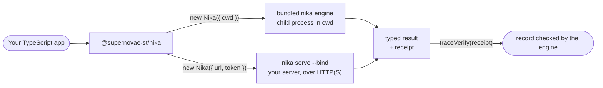
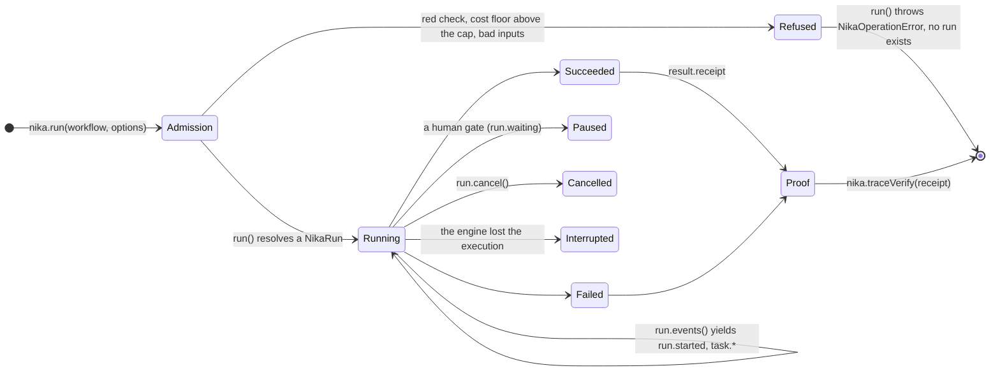

import { SDK, SourceContract } from "/snippets/_sdk-contract.mdx"

`@supernovae-st/nika` lets a TypeScript application run `.nika` workflows and
prove what they did. It is a thin, typed client: the Nika engine parses,
checks, runs and records every workflow, and the SDK carries the engine's
answers to your code. It never parses a workflow, re-implements a check or
computes a proof itself.

## Two doors, one client

One class, `Nika`, reaches the engine through one of two transports. The
constructor chooses; every method keeps its name and meaning on both.



- **Local engine** (`new Nika()`): the SDK starts the engine that npm installed
  with the package (`nika run <file> --json`, argv only, never through a
  shell), in your working directory. Nothing else runs on your machine.
- **Your server** (`new Nika({ url, token })`): the SDK talks to a
  `nika serve --bind` you operate. The server holds durable jobs and
  schedules, so a run survives your process restarting.

## The run lifecycle

`run()` returns only after the engine has admitted the workflow. Everything
after that is observation of one admitted run.



1. **Admission.** The engine checks the file (the same audit `nika check`
   prints), the inputs and the spend cap. A refusal makes `run()` throw a
   [`NikaOperationError`](/sdk/runtime/errors) carrying the engine's code; no
   run, event, trace or receipt exists.
2. **Observation.** `run.events()` streams lifecycle events in one vocabulary
   on both doors. [Events](/sdk/runtime/events) are presentation: optional to
   render, never the source of truth.
3. **Settlement.** `run.result()` resolves once with the engine's
   [result](/sdk/runtime/results): `succeeded`, `failed`, `paused`,
   `cancelled` or `interrupted`. An admitted failure resolves as data; it does
   not throw.
4. **Proof.** The result carries an engine-issued
   [receipt](/sdk/runtime/receipts). `traceVerify(receipt)` asks the engine to
   check the run's hash-chained record against it.

<video
  controls
  muted
  playsInline
  preload="none"
  className="w-full aspect-video rounded-xl"
  poster="/images/posters/sdk-doors.png"
  aria-label="Animated illustration of the two doors: new Nika() starts the bundled engine nika 0.123.0 as a child process and new Nika({ url, token }) reaches nika serve; lines 3 and 6 of demo.mts switch between them, line 3's cwd: process.cwd() becoming url, token, allowInsecureHttp: true and line 6's maxCostUsd: 0 becoming idempotencyKey; the engine refuses list-files.nika with NIKA-SEC-004 before any run exists, runs hello.nika, streams six local or two server events, seals six hash-chained journal lines and verifies the receipt, and one changed byte makes the verifier report BROKEN at line 5"
  alt="Animated illustration of the two doors: new Nika() starts the bundled engine nika 0.123.0 as a child process and new Nika({ url, token }) reaches nika serve; lines 3 and 6 of demo.mts switch between them, line 3's cwd: process.cwd() becoming url, token, allowInsecureHttp: true and line 6's maxCostUsd: 0 becoming idempotencyKey; the engine refuses list-files.nika with NIKA-SEC-004 before any run exists, runs hello.nika, streams six local or two server events, seals six hash-chained journal lines and verifies the receipt, and one changed byte makes the verifier report BROKEN at line 5"
>
  <source src="/videos/sdk-doors.mp4" type="video/mp4" />
</video>
<p className="mt-2 text-sm text-center opacity-80">**The lifecycle on both doors, as an illustration with captured content.** `new Nika()` and `new Nika({ url, token })` take the same methods; two lines of `demo.mts`, the quick start in the package README, change between them: line 3, the constructor, takes `url`, `token` and `allowInsecureHttp: true`, which a plain `http://` URL to a loopback host needs, and line 6, the run options, takes an `idempotencyKey` in place of `maxCostUsd`, which a server run refuses. Admission: the engine refuses `list-files.nika` with `NIKA-SEC-004`, `run()` throws `NikaOperationError` and no run exists, while `hello.nika` is admitted. Observation: six local events, or two from `nika serve`. Settlement: `run.result()` reads `succeeded`. Proof: six hash-chained journal lines end in `run_sealed`, `traceVerify(receipt)` answers `verified` locally and `sealed` from the server, and one changed byte makes the verifier report `BROKEN at line 5`. *An illustration: every code line, event, verdict, hash and version on screen was captured from `@supernovae-st/nika` 0.123.0, its bundled engine `nika 0.123.0 (0bfde3765)` and `nika serve` 0.123.0 in a `mock/echo` rehearsal; the cards, lanes, packets and pacing are drawn, and a real run takes milliseconds.*</p>

## Who owns what

| Concern | Owner | What that means |
|---|---|---|
| The `.nika` language, checks, permits, spend floors | Engine | The SDK sends the file or its name; it never interprets it |
| Execution, events, traces, receipts, seals | Engine | Proof comes from the engine; the SDK never constructs a receipt |
| Process spawning, HTTP, bounded event views, types | SDK | Argv only, plain HTTP only to loopback, every buffer bounded |
| Requests, business state, retries, idempotency keys | Your app | You decide when to run, what to store and what a result means |
| Provider keys, run-signing keys, server tokens | Your deployment | Never passed through SDK options or workflow inputs |

## The words the pages use

| Word | Meaning |
|---|---|
| **Workflow** | The `.nika` file, or its served name, that you pass in |
| **Admission** | The engine's check before anything starts. Refused: `run()` throws. Admitted: you get a `NikaRun` |
| **Run** | This client's handle on one admitted workflow (`run.id`) |
| **Job** | Over HTTP, the server's durable record of the run; `run.id` is its job id |
| **Execution** | The engine's own id for what actually ran (`execution_id`), carried by the receipt with the `trace_id` |
| **Settlement** | How a run ended: its status, cause, task tally and spend (`result.settlement`) |
| **Receipt** | The engine-issued pointer to the run's record. Locally it names a trace file; over HTTP, a job |
| **Sealed** | The record is signed with the machine's run-signing key, so `traceVerify` can attribute it |
| **Served name** | A workflow's path from the server's project root, such as `workflows/hello.nika` |
| **Resident** | A running `nika serve` process |

## What differs between the doors

Measured with `@supernovae-st/nika` 0.123.0 and its bundled engine, and
`nika serve` 0.123.0:

| | Local engine | `nika serve` |
|---|---|---|
| Construct | `new Nika({ cwd })` | `new Nika({ url, token })` |
| Workflow argument | a path relative to `cwd` | a served name from the project root, or an explicit local path (`./x.nika`) sent as a snapshot |
| `run()` options | `inputs`, `model`, `maxCostUsd` | `idempotencyKey` (required), `inputs` |
| Spend cap | `maxCostUsd`; a floor above it makes `run()` throw `NIKA-1709` | the server's `--run-cost-ceiling` (1 USD by default); a floor above it is a failed job |
| Events for a one-task run | six, including `task.*` | two: `run.started`, then `run.settled` or `run.waiting` |
| `run.id` | a throwaway id of this process | the durable job id: the one to store |
| `run.status()`, `attachRun()` | refused | durable status and reattachment |
| `run.cancel()` | signals the engine; the task in flight finishes, the result is `cancelled` | 202 `cancellation_requested`; `interrupted` if the run has not settled after the server's 5 s grace |
| A human gate | `paused`; resume from the CLI with `--resume <trace> --answer` | `paused`; 0.123.0 has no route to answer it |
| `traceVerify(receipt)` | `verified`, or `invalid` (`receipt_mismatch`) without a signing key | the server's verdict: `sealed`, or `ok` (intact, unsigned) |
| `schedule()`, `listWorkflows()` | refused | the server's schedules and served workflows |
| `compile()` | deterministic; `authoringModel` seats a model | deterministic; a model round needs a server started with `--authoring-model` |

Since 0.123.2, `run()` and `check()` also take `access`, the engine's access
pin, on both doors: a served name carries it as `JobByName.access` or
`CheckByName.access`, and a snapshot of a local file refuses it. On a server
only, `run.artifacts()` lists, and `run.readArtifact()` or
`run.downloadArtifact()` returns, the files a settled job's sealed journal
records; a local run's files are where its workflow wrote them
([Outputs and artifacts](/sdk/remote/artifacts)).

## Your first run, either door

The [quickstart](/sdk/start/quickstart) runs one workflow on the local engine
in five minutes; the [server quickstart](/sdk/remote/serve-quickstart) starts
`nika serve` and runs the same workflow over HTTP. The methods are the same,
and two lines change over HTTP: the constructor takes `url` and `token`
(with `allowInsecureHttp: true` for a plain `http://` URL to a loopback
host), and `run()` takes an `idempotencyKey` in place of `maxCostUsd`, which
a server run refuses. On the local engine:

```ts
import { Nika, isNikaRunSucceeded } from '@supernovae-st/nika'

const nika = new Nika({ cwd: process.cwd() })
const run = await nika.run<{ greeting: string }>('hello.nika', { maxCostUsd: 0 })
const result = await run.result()

if (isNikaRunSucceeded(result) && result.receipt) {
  console.log(result.outputs?.greeting)
  const proof = await nika.traceVerify(result.receipt)
  console.log(proof.verified, proof.verdict)
}
```

<Accordion title="Which version is this?">
  <SourceContract sdk={SDK} />
</Accordion>

<CardGroup cols={2}>
  <Card title="Quickstart" icon="play" href="/sdk/start/quickstart">
    Install, run, read the typed result and verify the receipt.
  </Card>
  <Card title="Server quickstart" icon="server" href="/sdk/remote/serve-quickstart">
    Start nika serve and drive it with the same client.
  </Card>
  <Card title="Results" icon="flag-checkered" href="/sdk/runtime/results">
    Statuses, settlement, outputs and exit codes.
  </Card>
  <Card title="Errors" icon="triangle-exclamation" href="/sdk/runtime/errors">
    What throws, what resolves, and why the difference matters.
  </Card>
</CardGroup>
