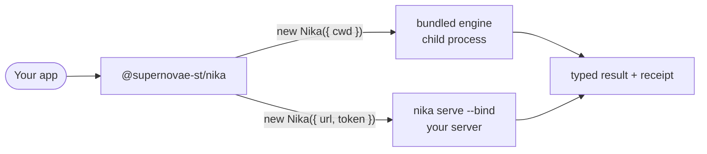

import { SDK, SourceContract, LocalContract, RemoteContract, SdkDoors } from "/snippets/_sdk-contract.mdx"
import { ProjectContract } from "/snippets/_project-contract.mdx"

`@supernovae-st/nika` runs `.nika` workflows from your application and proves
what they did. Your product owns the request, the interface and the business
state. The Nika engine owns parsing, admission, execution, policy, events,
receipts and traces, and the engine comes inside the npm package.

```sh
npm install @supernovae-st/nika@0.123.0
```

The first integration is two calls, admit and settle:

```ts
import { Nika, isNikaRunSucceeded } from '@supernovae-st/nika'

const nika = new Nika({ cwd: process.cwd() })

const run = await nika.run('hello.nika', { maxCostUsd: 0 })
const result = await run.result()

if (!isNikaRunSucceeded(result)) {
  // 'failed' carries the engine's error; 'paused' waits on a human gate
  throw new Error(`run ended as ${result.status}`)
}
console.log(result.outputs)
```

`run()` admits the workflow **before** it returns: a file the engine refuses
throws a typed `NikaOperationError`, and no handle is ever handed out.
`result()` is the one settlement: an admitted workflow that fails resolves as
`status: 'failed'` data, not a throw. The [quickstart](/sdk/start/quickstart)
runs this end to end in five minutes.

## Two doors, one client



```ts
const local = new Nika({ cwd: process.cwd() })
const remote = new Nika({
  url: 'https://nika.example.com',
  token: process.env.NIKA_TOKEN!,
})
```

Omit `url` for the local transport. Supply `url` and `token` for HTTP. On a
server, a served name such as `workflows/release.nika` (the workflow's path
from the server's project root) needs no local engine or file; an explicit
local path such as `./release.nika` uses a compatible local engine to capture
an immutable snapshot first. [How the SDK works](/sdk/how-it-works) compares
the two doors line by line.

## One lifecycle vocabulary

| Intent | Method | Door |
|---|---|---|
| Audit | `check(workflow, options?)` | both |
| Author a candidate | [`compile(request, options?)`](/sdk/local/compile) | both |
| Admit and execute | `await run(workflow, options?)` | both |
| Observe | [`run.events(options?)`](/sdk/runtime/events) | both |
| Settle | [`await run.result()`](/sdk/runtime/results) | both |
| Cancel | `run.cancel()` | both |
| Verify proof | [`traceVerify(receipt, options?)`](/sdk/runtime/receipts) | both |
| Recover a durable job | `attachRun(id, options?)` | HTTP only |
| Read live status | `run.status()` | HTTP only |
| Discover workflows | `listWorkflows()` · `workflow(name)` | HTTP only |
| Manage one schedule | [`schedule()` · `scheduleStatus()`](/sdk/remote/schedules) | HTTP only |

`run()` returns a handle only after admission; the handle is not a result.
Events are optional to render; `run.result()` is the run's one ending,
including a pause at a human gate. Locally, a paused run resumes from the
command line; `nika serve` 0.123.0 has no route to answer the gate.
Configuration, compatibility, transport and protocol failures throw typed
[errors](/sdk/runtime/errors).

<Accordion title="Compatibility aliases from earlier releases">
  `nika.events(run)`, `nika.cancel(run)`, `nika.status(run)` and `run.done`
  remain as deprecated aliases. `run.done` is the same promise as
  `run.result()`. New code should call the methods on the run handle:
  `run.events()`, `run.result()`, `run.cancel()`, `run.status()`.
</Accordion>

## Documentation map

<SdkDoors />

## Authority boundary

- The SDK does not parse a second Nika language.
- It does not reconstruct traces or receipts in TypeScript.
- An observer `AbortSignal` does not cancel a run; call `run.cancel()`.
- It does not infer success from an event kind.
- It exposes only the routes the released server answers.

## Version and channel

<Accordion title="Which published release these pages describe">
  <SourceContract sdk={SDK} />
  <ProjectContract />
  <LocalContract sdk={SDK} />
  <RemoteContract sdk={SDK} />
</Accordion>

<Card title="Review the published source" icon="github" href={SDK.sourceCandidate}>
  The source of the published SDK release and its engine payloads.
</Card>
